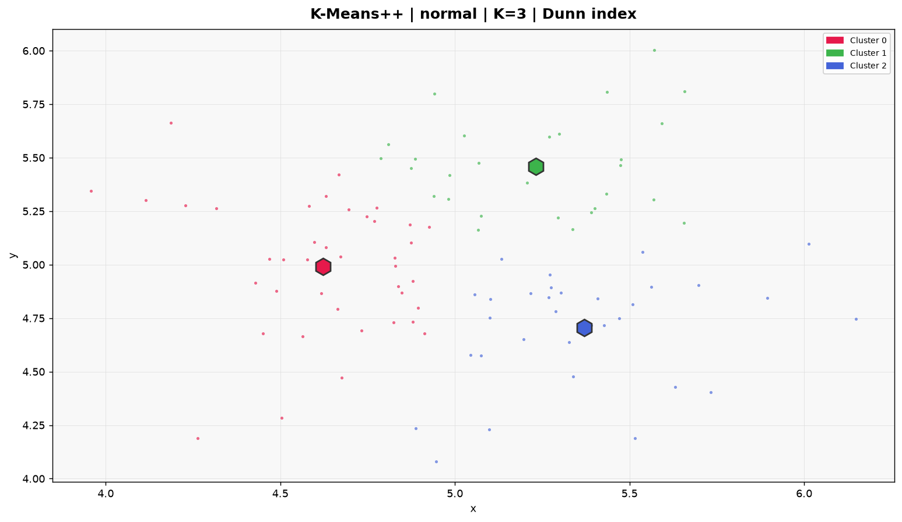
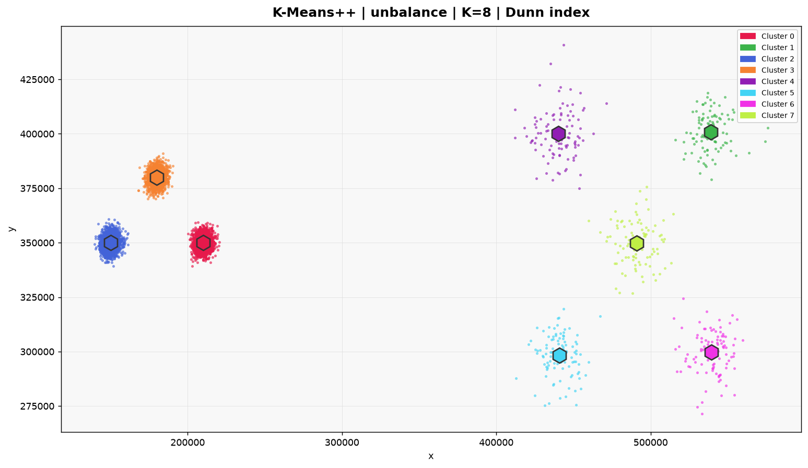

# Solution — K-Means Clustering

## Algorithm Overview

The solution implements **K-Means** with:

- **Random initialisation** (plain) and **K-Means++ initialisation** (smart)
- **Random Restart** — run R=100 times, keep the best result by chosen metric
- Three quality metrics: **WCSS** (inner), **min inter-centroid** (outer),
  and the **Dunn index** (combined)
- Output as a **scatter plot** (PNG) rendered by Python/matplotlib

---

## Implementation

### C++ core (`cpp/k_means.cpp`)

Handles all computation:

| Component | Location |
|-----------|----------|
| Point + squared-distance helper | `sqDist()` |
| Data loading | `readPoints()` |
| Random centroid init | `initRandom()` |
| K-Means++ init | `initPlusPlus()` |
| Single K-Means run | `runKMeans()` |
| WCSS metric | `wcss()` |
| Min inter-centroid metric | `minInterCentroid()` |
| Dunn index metric | `dunnIndex()` |
| Random restart loop | `randomRestart()` |
| CSV result writer | `writeResult()` |

### Python visualiser (`plot.py`)

Reads the CSV written by the C++ binary and produces a PNG scatter plot.
Each cluster gets a distinct colour; centroids are shown as bold hexagons.

---

## Initialisation: Random vs K-Means++

### Random

Centroids are drawn uniformly from the bounding box of the data:

```
for k in 0..K:
    centroid[k] = (uniform(minX, maxX), uniform(minY, maxY))
```

### K-Means++

Guarantees initial spread across the data — O(log K) approximation bound:

```
c[0] = random point from dataset
for k = 1..K-1:
    D[i] = min dist²(point[i], c[0..k-1])   # for all i
    c[k] = sample with probability ∝ D[i]
```

The D² weighting makes it far more likely to pick the next centroid
far from existing ones, avoiding the "all centroids in one dense region"
failure mode of pure random init.

---

## Quality Metrics

### 1. WCSS — Within-Cluster Sum of Squares (inner distance)

```
WCSS = Σᵢ dist²(pointᵢ, centroid[labelᵢ])
```

Lower is better. The standard objective K-Means minimises.

### 2. Min Inter-Centroid Distance (outer distance)

```
inter = min_{i≠j} dist²(centroid[i], centroid[j])
```

Higher is better. Measures how well-separated the clusters are.

### 3. Dunn Index (combination of inner + outer)

```
Dunn = min_inter / max_intra_diameter
```

where `max_intra_diameter ≈ 4 × max_k(max dist²(point, centroid_k))`.

Higher is better. A high Dunn index means clusters are compact **and** separated.

---

## Random Restart

Each restart uses an independent RNG state drawn from the same seeded `mt19937`.
After R=100 restarts the best solution (by chosen metric) is returned.

```
best_score ← worst possible
for r in 0..R:
    centroids ← init(pts, K)          // random or K-Means++
    result    ← runKMeans(pts, centroids)
    score     ← metric(result)
    if score improves best_score:
        best ← result
return best
```

---

## Complexity

| Phase | Time per restart | Space |
|-------|-----------------|-------|
| Random init | O(K) | O(K) |
| K-Means++ init | O(n·K) | O(n) |
| Single K-Means run | O(n·K·I) | O(n+K) |
| R restarts | O(R·n·K·I) | O(n+K) |

Where n = points, K = clusters, I = max iterations (300), R = 100.  
For unbalance (n=6500, K=8): ~1.6 M distance evaluations per restart — fast.

---

## Dunn Index Approximation Note

The exact Dunn intra-diameter requires O(n²) per cluster (all pairs).
Instead, the implementation uses `2 × max(point-to-centroid distance)` per
cluster — O(n) per cluster. This is a strict lower bound on the true diameter,
so the relative ordering of restarts is preserved and the best solution is
still correctly selected.

---

## Build & Run

```bash
# C++ — compile
clang++ -std=c++17 -O2 -o cpp/k_means cpp/k_means.cpp

# C++ — run (non-interactive: Dunn index + K-Means++ defaults)
./cpp/k_means datasets/normal/normal.txt 3
./cpp/k_means datasets/unbalance/unbalance.txt 8

# Java — compile & run
javac java/src/KMeans.java -d java/out
java -cp java/out KMeans datasets/normal/normal.txt 3
java -cp java/out KMeans datasets/unbalance/unbalance.txt 8

# Python — run
python3 python/k_means.py datasets/normal/normal.txt 3
python3 python/k_means.py datasets/unbalance/unbalance.txt 8

# Plot (reads result.csv written by any of the above)
python3 python/plot.py <result.csv> "Title" output.png

# Convenience wrapper (C++ + plot in one step)
./run.sh normal 3
./run.sh unbalance 8
```

---

## Results

### normal.txt — K=3

The dataset has 100 mildly overlapping points.
K-Means++ with Dunn-index selection consistently finds three well-separated
regions even though the clusters partially overlap.



### unbalance.txt — K=8

The dataset has 6500 points forming 8 Gaussian blobs of unequal size.
K-Means++ with Dunn-index selection recovers all 8 blobs reliably across
restarts, including the small sparse blobs that plain random init sometimes
splits or merges.



---

## Why K-Means++ Wins on Unbalanced Data

Plain random init places all K centroids in the densest region ~(K−1)/K of
the time, leaving sparse blobs uncovered. K-Means++ spreads them out
proportionally to D², so each blob almost always receives at least one seed.
Random restart further reduces the small residual failure probability.

---

## Source Files

| File | Purpose |
|------|---------|
| `cpp/k_means.cpp` | C++17 K-Means + K-Means++ + Random Restart + 3 metrics |
| `java/src/KMeans.java` | Java 17+ equivalent |
| `python/k_means.py` | Python 3 equivalent |
| `python/plot.py` | Python scatter-plot renderer (matplotlib) |
| `run.sh` | Convenience wrapper (C++ + plot) |
| `datasets/normal/normal.txt` | 100-point dataset |
| `datasets/unbalance/unbalance.txt` | 6500-point dataset |
